# Capturas de Galaga 3D

La versión anterior del juego utiliza nuestras naves y enemigos. Las capturas automáticas proceden del render real de OpenGL: conservan la geometría, la iluminación, el HUD y el buffer de profundidad del ejecutable. También se incluye una captura de la ventana de la aplicación.

Hay dos grupos. Las capturas **naturales** siguen una partida completa mediante un piloto que solo mueve, dispara y cambia de arma con los controles del juego. Las capturas **fixture** usan estados preparados para revisar una nave, un arma o un efecto concreto; por sí solas no demuestran que se haya completado la partida. El [informe de render](render-report.txt) y el [índice de imágenes](indice_capturas.csv) identifican el origen de cada archivo.

## Naves y enemigos

Flecha, Delta y Doble Motor en la selección. Esta imagen se tomó de la ventana real, donde se comprobó la selección con el teclado. Esa revisión se limitó al menú; el combate y el resto de las pantallas se verificaron por separado mediante las pruebas y las capturas automáticas descritas abajo.

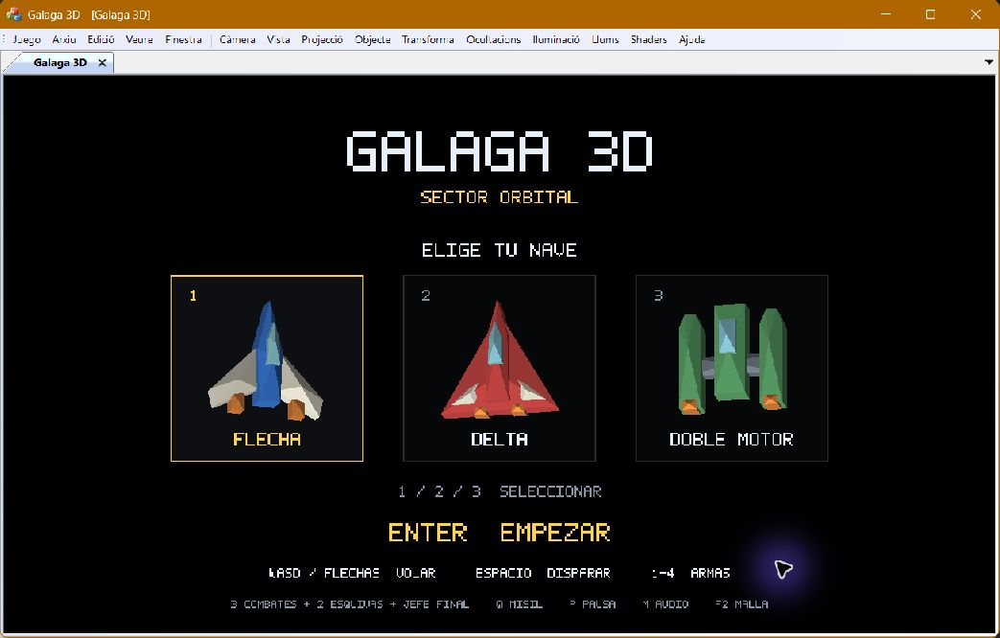

Los tres modelos y los enemigos, vistos de cerca en la galería de comprobación (fixture).

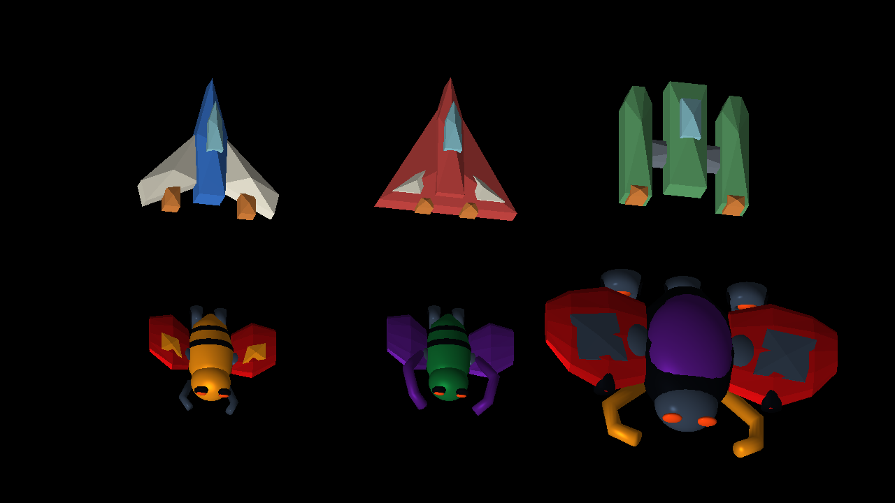

| Nave | Selección | En combate, estado preparado |
| --- | --- | --- |
| Flecha | [Menú](01-menu.png) | [Combate](03-combat-flecha.png) |
| Delta | [Menú](02-delta-selected.png) | [Combate](03-combat-delta.png) |
| Doble Motor | [Menú](02-doble-motor-selected.png) | [Combate](03-combat.png) |

Estas son las referencias 2D originales, copiadas sin cambios desde `Recursos_Galaga2D/sprites/naves` de la prueba 2D. Permiten comparar siluetas y colores con los modelos de arriba.

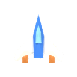
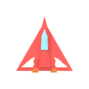
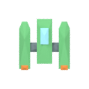

## Partida completa con controles normales

El piloto completó las tres oleadas, las dos fases de esquiva y el jefe: 46 bajas, 7.825 puntos y tres vidas al terminar. Fueron 75,62 segundos de simulación. Las seis imágenes de las etapas se toman al superar sus dos primeros segundos; no se alteran vidas, enemigos ni cambios de etapa para obtenerlas.

Primer combate.

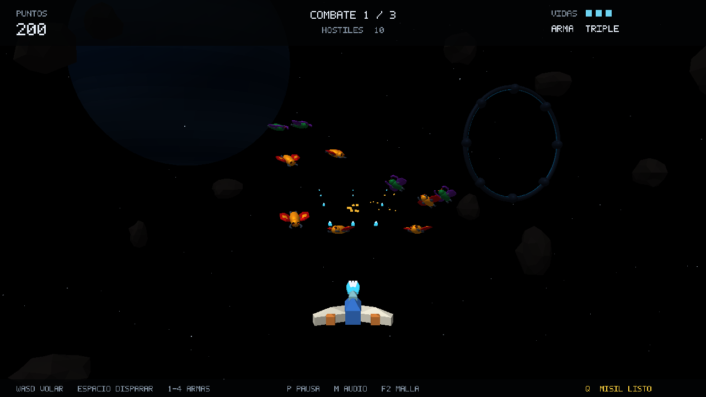

Primera fase de esquiva, con cámara desde la cabina.

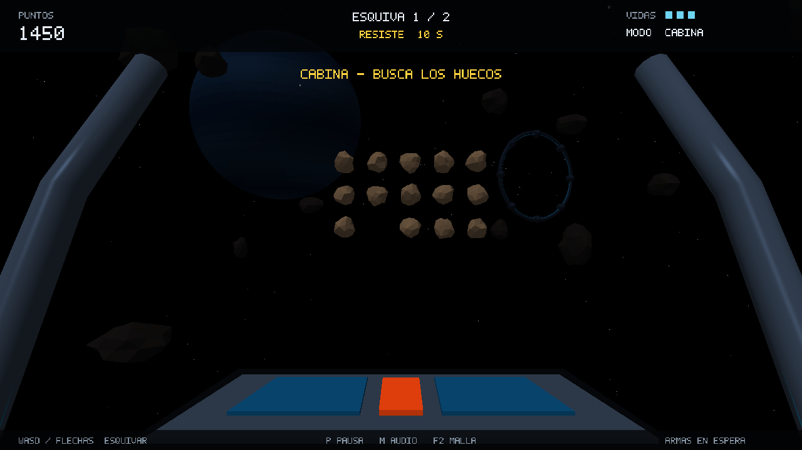

Segundo combate.

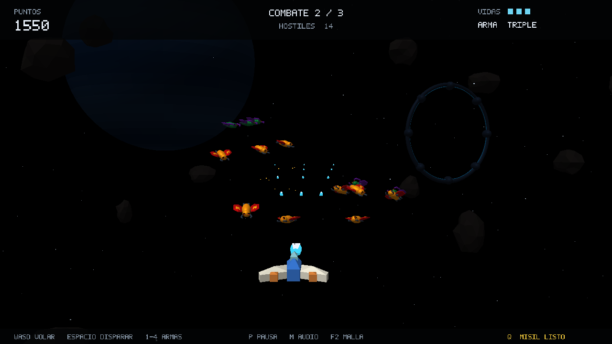

Segunda fase de esquiva.

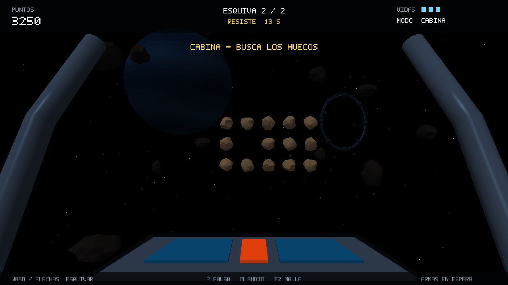

Tercer combate.

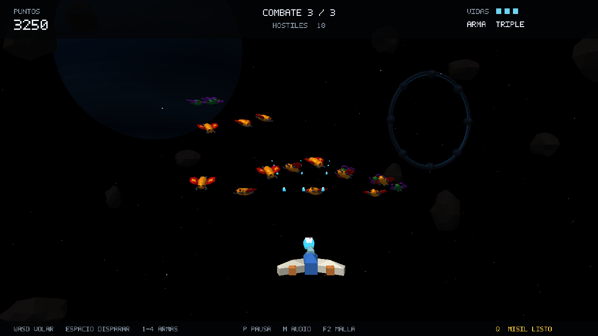

Jefe final.

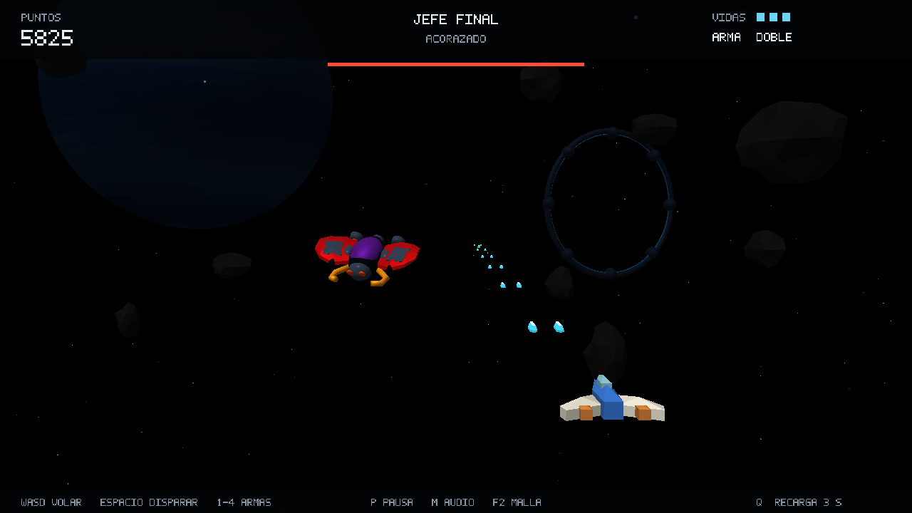

Victoria obtenida al derrotar al jefe.

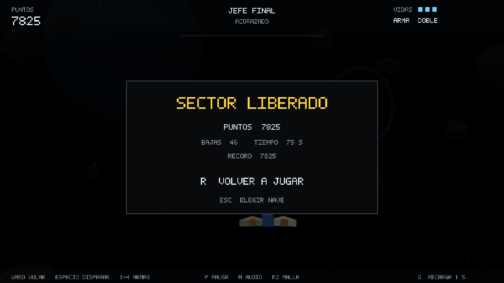

La derrota se comprueba en otra partida, dejando al jugador inmóvil hasta agotar sus vidas.

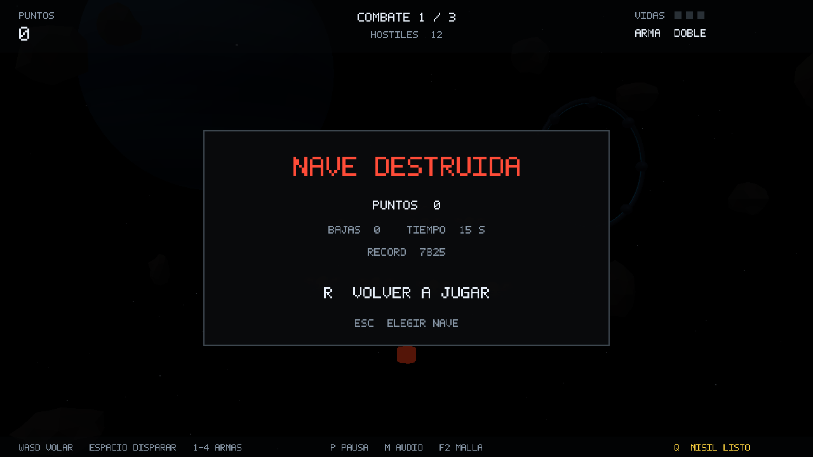

## Armas y respuesta a impactos

Las imágenes de esta tabla son fixtures: comparan armas y efectos a partir de estados preparados de la misma versión.

| Comprobación | Capturas |
| --- | --- |
| Cuatro armas | [Simple](15-weapon-1.png) · [Doble](15-weapon-2.png) · [Triple](15-weapon-3.png) · [Misil](15-weapon-4.png) |
| Apuntar, disparar y acertar | [Alineación](11-aligned-shot.png) · [Bala en vuelo](12-shot-in-flight.png) · [Impacto confirmado](13-confirmed-hit.png) |
| Ataque enemigo | [Picado](16-enemy-dive.png) · [Aviso](19-warning-start.png) · [Pulso del aviso](20-warning-pulse.png) |
| Daño y protección en combate | [Daño](21-damage-combat.png) · [Protección](22-protected-flight.png) · [Protección en 4:3](22-protected-flight-4x3.png) |
| Daño y protección en cabina | [Daño](23-damage-cockpit.png) · [Protección en 4:3](24-protected-cockpit.png) |
| Disparo especial | [Recarga del misil](26-special-recharge.png) |
| Pausa | [Combate](06-pause.png) · [Cabina](25-cockpit-pause.png) |

## Cabina, profundidad y malla

Cabina en formato 4:3. Es un fixture para comprobar el encuadre y el HUD.

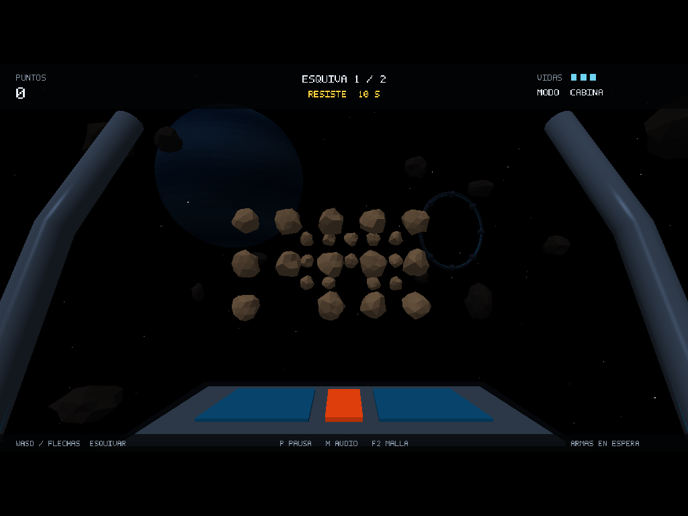

La galería en modo malla permite revisar la geometría de los modelos (fixture).

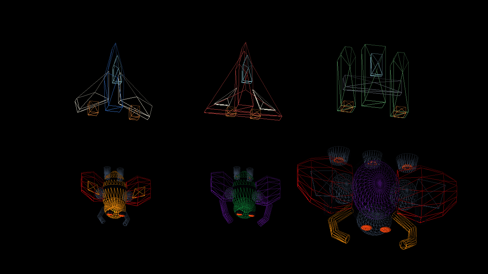

| Otras comprobaciones | Capturas |
| --- | --- |
| Formato y profundidad | [Combate 4:3](04-combat-4x3.png) · [Niveles de profundidad](05-depth-levels.png) · [Repetición sin avanzar el tiempo](05-static-repeat.png) |
| Límites de vuelo en combate | [Izquierda](04-left-limit.png) · [Derecha](04-right-limit.png) · [Superior derecho](04-upper-right-limit.png) · [Inferior izquierdo](04-lower-left-limit.png) |
| Cabina y abertura entre obstáculos | [Vista 16:9](17-cockpit-evasion.png) · [Abertura cercana](28-cockpit-opening-close.png) |
| Límites de vuelo en cabina | [Superior derecho](27-cockpit-upper-right.png) · [Inferior izquierdo](27-cockpit-lower-left.png) |
| Jefe preparado | [Presentación del jefe](18-boss.png) |
| Galería girada | [Vista lateral](10-models-side.png) |
| Pantallas de resultado preparadas | [Victoria fixture](07-victory-fixture.png) · [Derrota fixture](08-defeat-fixture.png) |
| Inicio de la partida natural | [Entrada a la primera oleada](30-natural-campaign-start.png) |

La carpeta contiene 51 capturas automáticas del render, una captura de la ventana real y las tres referencias 2D. Las imágenes se conservan sin retoques. El informe registra OpenGL 4.6 en AMD Radeon 840M, las comprobaciones de iluminación y reutilización de buffers, y el recorrido natural completo del piloto.
