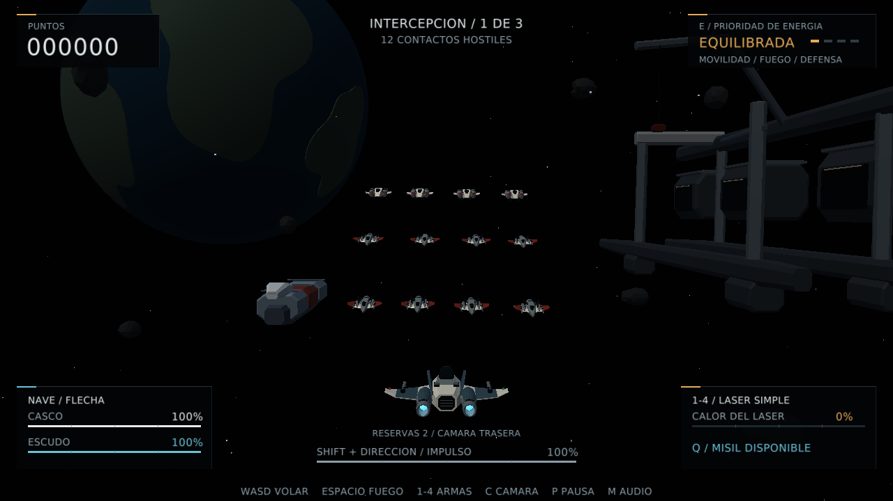

# Galaga 3D · VGI

**Descargas para enseñar y comparar:** [versión actual y anterior para Windows](https://github.com/aminelalam/VGI-Galaga/releases/tag/comparativa-2026-11-12).

| Paquete | Versión del código | Contenido |
| --- | --- | --- |
| `Galaga3D-Anterior-cc3ced6-Windows.zip` | [cc3ced6](https://github.com/aminelalam/VGI-Galaga/tree/cc3ced65878d21a25af445dcc3eb670e831aa792) | Naves de colores, escenario y HUD anteriores; movimiento directo. |
| `Galaga3D-Actual-f097858-Windows.zip` | [f097858](https://github.com/aminelalam/VGI-Galaga/tree/f0978585eb19ae4b5f3bf34f822e9433638857e4) | Diseño industrial, HUD nuevo, inercia, impulso, energía, casco, escudo y calor. |

Descarga el ZIP de cada versión, **extrae toda su carpeta y abre `Galaga3D.exe`**. Incluyen recursos, bibliotecas y Mesa OpenGL; se pueden ejecutar sin compilar ni instalar Visual Studio. Las dos versiones se han verificado desde sus carpetas de distribución. Cada paquete incluye instrucciones, una captura, su revisión exacta y hashes SHA-256. El resto de este README describe la versión actual.

Juego nativo en C++/MFC/OpenGL, integrado en la estructura de EntornVGI. La campaña encadena **tres combates, dos tramos de esquiva desde la cabina y un jefe final**. Puedes elegir entre tres cazas y moverte a izquierda, derecha, arriba y abajo. Los enemigos entran en formación a diferentes distancias y alturas, disparan y realizan picados en el espacio 3D.

La revisión de dirección visual incorpora cascos industriales, alas y armas con grosor, toberas, superficies metálicas y cristales. El sector contiene un planeta, un astillero lateral y un carguero. El HUD organiza casco, escudo, armas y movilidad alrededor de la vista de vuelo. La gestión de energía, el calor del láser y el impulso añaden decisiones durante las formaciones de Galaga.

Las naves, enemigos y escenario son [mallas OBJ/MTL cargadas por el juego](Recursos_Galaga3D/modelos/README.md), con vértices, triángulos y normales. Se pueden editar en [Mallas_Galaga3D.blend](Recursos_Galaga3D/blender/Mallas_Galaga3D.blend). La perspectiva, las ocultaciones y la iluminación muestran su volumen; **F2** permite inspeccionar los triángulos durante el juego.

Esta implementación está en la rama **`codex/mallas-3d-escenario`**. Ejecuta **`build-demo.cmd`** desde su copia local para compilar, lanzar las comprobaciones y preparar **`dist/Galaga3D/Galaga3D.exe`**. Conserva toda la carpeta `dist/Galaga3D` al distribuir el juego. Incluye Mesa local para ejecutar OpenGL cuando el controlador del equipo no ofrece la versión necesaria.

**Controles:** en el menú, 1/2/3 eligen nave y Enter empieza. En partida, WASD o flechas mueven en horizontal y altura; **Shift + dirección** activa el impulso; **E** cambia la prioridad de energía y **C** alterna cámara trasera/cabina durante el combate. Espacio dispara; 1/2/3/4 eligen disparo simple, doble paralelo, triple o misil; Q lanza el misil auxiliar con recarga. P pausa, M activa o silencia el audio y F2 muestra la malla. R reinicia tras el resultado; Esc pausa o vuelve al menú.

El movimiento acelera y frena de forma gradual. Priorizar motores, armas o escudos cambia velocidad, enfriamiento y recuperación; el impulso consume carga e impide disparar mientras está activo. El escudo absorbe daño y se regenera tras cuatro segundos sin recibir impactos. Solo destruir el casco consume una nave de reserva. El láser se bloquea si alcanza el calor máximo.

El avance se representa en un sistema relativo al vuelo: controlas **X** y **Z**; las trayectorias y el desplazamiento del entorno expresan el avance en **Y**. La cabina es opcional en combate y obligatoria durante la esquiva. Se mantienen las formaciones, los picados, la puntuación y la campaña breve. El [audio original generado matemáticamente](Recursos_Galaga3D/audio/README.md) utiliza fondos sostenidos, pulsos graves y efectos de energía.

[Instrucciones, arquitectura y verificación](DEMO_3D.md) · [Solución Visual Studio 2022](Entrega_Amin_VGI/entornsGrafics/Galaga3D.sln)

La revisión del 12 de noviembre pasa **108 comprobaciones de reglas y la verificación gráfica Release**. Incluye una campaña completa mediante entradas normales y regresiones de inercia, energía, calor, escudos, impulso, colisiones y combos. Los hallazgos y los límites de esta evidencia están en [REVISION_JUEGO.txt](REVISION_JUEGO.txt).



[Vista desde la cabina](Recursos_Galaga3D/previews/Mallas/Cabina.png) · [Modelos sólidos](Recursos_Galaga3D/previews/Mallas/Modelos.png) · [Triángulos de las mallas](Recursos_Galaga3D/previews/Mallas/Mallas.png) · [Informe gráfico Release](Recursos_Galaga3D/previews/Mallas/Verificacion_Release.txt)

[Aviso de picado](Recursos_Galaga3D/previews/Mallas/Aviso_picado.png) · [Daño en cabina](Recursos_Galaga3D/previews/Mallas/Dano_cabina.png) · [Paso entre asteroides](Recursos_Galaga3D/previews/Mallas/Paso_asteroides.png)

[Cabina de combate](Recursos_Galaga3D/previews/Mallas/Cabina_combate.png) · [Energía](Recursos_Galaga3D/previews/Mallas/Energia.png) · [Calor del láser](Recursos_Galaga3D/previews/Mallas/Calor_laser.png) · [Impulso](Recursos_Galaga3D/previews/Mallas/Impulso.png)

[Guía del código en PDF](docs/Guia_completa_codigo_Galaga3D.pdf). Documenta la revisión del 1 de noviembre de 2026; sus listados y alcance son anteriores a esta campaña. [Revisión técnica y relación con VGI](REVISION_JUEGO.txt). Las instrucciones de la implementación actual están en [DEMO_3D.md](DEMO_3D.md).

Los modelos se cargan una vez en VBO/EBO/VAO. Los enemigos lejanos usan una variante de menor detalle. Cada instancia envía `model` y la matriz normal al shader; `view` y `projection` definen la cámara. Los atributos 4 y 5 transportan brillo (`Ks`, `Ns`) y emisión (`Ke`). Se conserva la iluminación Phong de GL-6 y se añade un relleno ambiental suave. La implementación y su relación con GL-3, GL-4, GL-6 y GL-7 se explican en [DEMO_3D.md](DEMO_3D.md).

Los PDF, actas y hojas de cálculo originales se conservan como documentación de referencia. Algunos describen propuestas anteriores, incluidos los planos A/B. La campaña actual usa movimiento continuo en horizontal y altura. El MVP privado aparte queda fuera de esta entrega y de su publicación.

## 📊 Un Excel para mantener el proyecto

El libro integral conecta **52 requisitos, 60 casos de prueba y 40 tareas**.

| Hoja | Para qué sirve |
| --- | --- |
| 🏠 Inicio | Fechas, semana de consulta, avance, alertas y gráfico de carga. |
| ✅ Tareas | Responsables, apoyos, horas, dependencias, entregables y evidencias. |
| 🎯 Requisitos | Alcance, criterios verificables y aceptación de cada entrega. |
| 🧪 Pruebas | Preparación, pasos, resultado esperado, build y evidencia. |
| 🗓️ Calendario | Vista automática de tareas por semana. |
| 👥 Equipo | Disponibilidad, carga pendiente y sobrecargas. |
| 💬 Acuerdos | Decisiones, riesgos y cambios de criterio. |
| 📖 Guia | Instrucciones de uso y mantenimiento. |

**Rutina de cada reunión:** actualizar fecha y semana → revisar las tareas de cada persona → resolver bloqueos y carga → registrar pruebas y acuerdos.

- 🟨 **Ámbar:** entradas editables.
- 🟦 **Azul claro:** cálculos que se deben conservar.
- 📎 Una tarea `Hecha` necesita **evidencia, revisor y fecha** para contar como aceptada.
- 🧪 Un requisito necesita tarea aceptada, pruebas válidas y aceptación registrada.
- 🔢 Conservar los ids al ordenar o filtrar. Añadir registros dentro de las tablas.
- 🤝 Mantener **una única copia compartida** del Excel.

La planificación propone **209 horas P0/P1 en 13 semanas**, con **8 h por persona y semana** por confirmar. Activar P2 añade 11 horas. Las fechas reales, disponibilidad y alcance se acuerdan con el equipo y el enunciado del curso.

📖 [Guía completa de uso](Entrega_Amin_VGI/Gestion_y_diseno/LEEME.md) · 🔍 [Informe de revisión](Entrega_Amin_VGI/Gestion_y_diseno/Revision_de_la_entrega.md)

## 👥 Equipo y coordinación

| Persona | Área que coordina |
| --- | --- |
| Pablo | 🔎 Estado del arte |
| Amin | 🧠 Diseño de aplicación |
| Ferran | 🖥️ Interfaz |
| Iker | 🛠️ Implementación |
| Uri / Oriol | 🧪 Pruebas |
| David | 📝 Memoria y presentación |

La aportación principal de Amin consiste en concretar **reglas, estados, entidades, rutas, oleadas, colisiones y profundidad**, y preparar sus criterios de verificación. El acta recoge también su apoyo a las otras áreas.

## 🖥️ Abrir los materiales en tu ordenador

1. En GitHub, selecciona la rama **codex/mallas-3d-escenario** y pulsa **Code → Download ZIP**, o clona esa rama:

   ```bash
   git clone --branch codex/mallas-3d-escenario https://github.com/aminelalam/VGI-Galaga.git
   ```

2. Extrae la carpeta completa si descargaste el ZIP.
3. Abre `Entrega_Amin_VGI/INICIO.html` en tu navegador.
4. Abre los PDF para leer y los archivos Word/Excel para editar.

La portada, diagramas, maqueta y tráiler descargado funcionan localmente. Los enlaces a fuentes externas requieren internet. El HTML se debe abrir desde la copia descargada; en GitHub se muestra su código.

## 📁 Organización

Los modelos editables de Blender, OBJ/MTL, audio, sprites PNG/SVG y atlas están en [Recursos_Galaga3D](Recursos_Galaga3D/README.md). Los materiales gráficos de propuestas anteriores se conservan junto a los recursos del juego. La implementación C++ de la campaña está en `Entrega_Amin_VGI/entornsGrafics/EntornVGI`.

```text
Entrega_Amin_VGI/
├── Resumen_Amin_VGI.pdf              # Tu parte en una página
├── INICIO.html                      # Portada, maqueta y recursos
├── Dossier_Amin_Galaga3D.pdf          # Dossier de consulta
├── Dossier_editable.md               # Versión de texto editable
├── Guion_reunion.md
├── Tareas_para_el_grupo.md
├── CREDITOS.md
├── Gestion_y_diseno/
│   ├── 01_Gestion_integral_Galaga3D.xlsx
│   ├── 03_Diseno_detallado_Amin.xlsx
│   ├── Diseno_tecnico_Galaga3D_Amin.docx
│   ├── Diseno_tecnico_Galaga3D_Amin.pdf
│   ├── LEEME.md
│   ├── Revision_de_la_entrega.md
│   └── figuras/
└── recursos/                        # Acta, imágenes, diagramas y vídeo
```

## 🧭 Alcance y comprobación

La implementación incluye campaña, cuatro armas, misil auxiliar, vuelo con inercia en X/Z, gestión de energía, casco y escudo, impulso, dos vistas de combate y esquivas desde cabina. Las mallas y los shaders se integran en la plantilla de VGI. Las skins, las cajas de recompensas y una economía de partida siguen como propuestas de las actas.

`build-demo.cmd` ejecuta las pruebas de lógica y la verificación gráfica antes de preparar el paquete. Release pasa 108 comprobaciones en esta revisión. Las capturas del ejecutable se han inspeccionado; la comodidad de vuelo, dificultad percibida y mezcla de sonido quedan pendientes de una sesión manual. Las verificaciones Debug anteriores pertenecen a versiones anteriores.

## 🎨 Fuentes y créditos

El referente de formaciones y puntuación es **Galaga**, de Bandai Namco. Para esta revisión se estudió la [gestión de energía de Squadrons descrita por EA](https://www.ea.com/ea-studios/motive/news/pilot-briefing-gameplay-overview) y la [dirección de vuelo explicada por sus creadores](https://www.starwars.com/news/star-wars-squadrons-interview). La adaptación usa esos principios en el corredor del proyecto; conserva modelos y sonidos originales y no incorpora recursos de Star Wars. No es un simulador de vuelo libre en seis ejes. Los valores de balance son propios.

El HUD usa la fuente Bitstream Vera incluida con su licencia en `Recursos_Galaga3D/fonts`; el atlas se puede regenerar con `scripts/generar_fuente_hud.py` dentro de Recursos_Galaga3D. Las imágenes y el tráiler externos de la documentación anterior conservan sus atribuciones en [CREDITOS.md](Entrega_Amin_VGI/CREDITOS.md).

📋 [Acta original del grupo](Entrega_Amin_VGI/recursos/acta_original.pdf)

---

**🚀 Un diseño que podamos explicar, implementar y comprobar juntos.**
