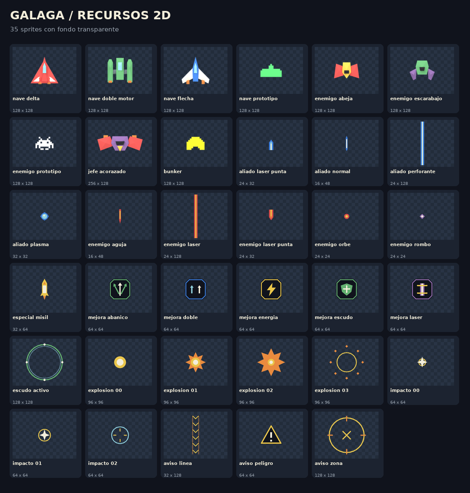

# Modelos y recursos 2D de Galaga

Recursos gráficos para la prueba en 2D: naves, enemigos, disparos, mejoras, efectos y avisos de peligro. Las naves Flecha, Delta y Doble Motor mantienen los modelos y colores de las referencias del grupo.

## Contenido

| Carpeta | Recursos |
| --- | --- |
| `sprites/naves/` | Flecha, Delta, Doble Motor y nave del prototipo del grupo. |
| `sprites/enemigos/` | Abeja, Escarabajo, enemigo del prototipo y Acorazado. |
| `sprites/disparos/` | Balas aliadas y enemigas, plasma, misil y piezas de láser. |
| `sprites/mejoras/` | Doble disparo, abanico, láser, escudo y energía. |
| `sprites/efectos/` | Impacto, explosión y escudo activo. |
| `sprites/avisos/` | Peligro, columna de ataque y zona peligrosa. |
| `sprites/escenario/` | Búnker del prototipo del grupo. |
| `vector/` | Versiones SVG editables de disparos, mejoras, efectos y avisos. |
| `atlas/` | Atlas PNG de 1024 × 512 y sus coordenadas JSON. |
| `datos/` | Catálogo, dimensiones, pivots, secuencias y comprobaciones de los archivos. |

Hay **35 PNG transparentes y 26 SVG**. Las naves y enemigos son de 128 × 128 píxeles; el Acorazado es de 256 × 128. Las imágenes se pueden usar por separado o desde el atlas.

## Coordenadas y transparencia

`datos/catalogo.json` reúne los nombres, rutas, pivots y orientaciones. Los rectángulos de `atlas/galaga_2d.json` son `[x, y, ancho, alto]`, con origen arriba a la izquierda. El pivot se mide sobre el PNG completo; el margen transparente no define la zona de colisión.

Los PNG usan alpha recto. En OpenGL: `GL_SRC_ALPHA` y `GL_ONE_MINUS_SRC_ALPHA`. `uv_top_left` corresponde a cargar las filas sin invertir; `uv_bottom_left`, a invertirlas al cargar. Aplicar una sola convención.

Los láseres tienen un tramo repetible y una punta separada. Las secuencias de impacto y explosión, y los ejemplos visuales de doble disparo y abanico, están en `datos/efectos.json`. Las velocidades, el daño y las reglas pertenecen a la aplicación que utilice los gráficos.

## Procedencia

Las entidades se han exportado con cámara ortográfica desde los modelos del proyecto. Los prototipos de nave, enemigo y búnker proceden de `Recursos_Galaga3D/blender/prototips.blend`. Las otras entidades proceden de `Recursos_Galaga3D/scripts/retro_modelos.py`. `datos/modelos.json` conserva las referencias y hashes de las fuentes.

La hoja de consulta utiliza Bitstream Vera, cuya fuente y licencia están en `Recursos_Galaga3D/fonts/`. `datos/validacion.json` recoge la revisión de transparencia, márgenes, SVG y píxeles del atlas.
