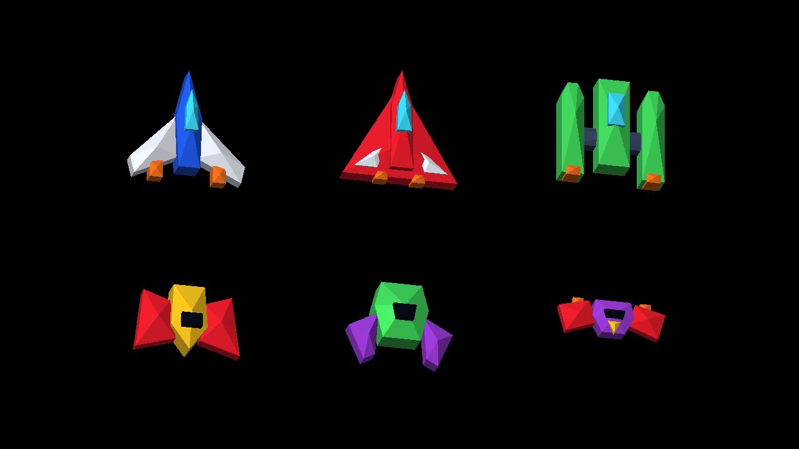

# Mallas 3D del juego

El archivo [Mallas_Galaga3D.blend](../blender/Mallas_Galaga3D.blend) contiene dos escenas editables. `01_Modelos` reúne las tres naves, la abeja, el escarabajo y el jefe. `02_Escenario` presenta una plataforma orbital, sus estructuras laterales y la formación de enemigos desde la cámara del jugador.

Los diseños reutilizan los constructores de `scripts/retro_modelos.py` y las siluetas de los recursos del proyecto. Cada pieza tiene base, laterales y caras superiores con volumen. Los colores se guardan en materiales sólidos y el sombreado es plano.

| Archivo | Triángulos | Piezas cerradas |
| --- | ---: | ---: |
| nave_flecha.obj | 92 | 6 |
| nave_delta.obj | 94 | 7 |
| nave_doble_motor.obj | 114 | 7 |
| enemigo_abeja.obj | 60 | 4 |
| enemigo_escarabajo.obj | 64 | 4 |
| jefe_acorazado.obj | 102 | 7 |
| escenario_orbital.obj | 396 | 33 |

Los siete archivos suman 922 triángulos. Cada OBJ va acompañado de su MTL. `catalogo.json` registra sus límites espaciales y el número de piezas. Las piezas pueden intersectarse para formar una nave, y cada pieza se comprueba como un sólido cerrado con orientación exterior.



[Vista de los triángulos](../previews/Mallas/Mallas.png) · [Escenario durante la partida](../previews/Mallas/Partida.png)

## Editar y exportar

Abre el archivo Blender y selecciona una escena en el selector superior. Las piezas de cada modelo cuelgan de un objeto raíz con la propiedad `export_obj`. Edita las piezas en sus coordenadas locales. Las instancias del escenario comparten las mallas del catálogo.

El eje X es lateral, Y es avance y Z es altura. Las naves apuntan a +Y y los enemigos a -Y. El escenario ya está expresado en coordenadas del mundo. La escala de exportación de las naves se ajusta a la cámara y a los volúmenes de contacto de la demo.

Para exportar tus cambios desde el archivo guardado, ejecuta desde la raíz del repositorio, usando la ruta de tu instalación de Blender.

```powershell
blender --background Recursos_Galaga3D/blender/Mallas_Galaga3D.blend --python-exit-code 1 --python Recursos_Galaga3D/scripts/generar_mallas_juego.py -- --export-only
```

Aplica los modificadores antes de exportar. El exportador triangula las caras y genera normales por cara y UV planas a partir de X/Y. Verifica las aristas compartidas, el volumen firmado y los triángulos degenerados. Conserva los objetos raíz y la propiedad `export_obj` para identificar los siete archivos de salida.

Para reconstruir los diseños iniciales, el siguiente comando sustituye el archivo Blender y los OBJ/MTL generados. Guarda aparte cualquier edición manual antes de usarlo.

```powershell
blender --background --factory-startup --python-exit-code 1 --python Recursos_Galaga3D/scripts/generar_mallas_juego.py
```

## Carga en EntornVGI

`Mesh3D::loadObj` lee posiciones, UV, normales y el color `Kd` del MTL. Acepta caras triangulares con índices `v/vt/vn`, positivos o negativos. Los MTL deben acompañar al OBJ en la misma carpeta. El exportador incluido produce este formato. Los archivos ausentes, las caras sin triangular y los índices incorrectos generan un error con el nombre del archivo y su línea.

Los datos se convierten al formato intercalado `MeshVertex`. Cada modelo se sube una vez con `GL_STATIC_DRAW`. El VAO describe los atributos y cada dibujo reutiliza el buffer. Las matrices `model`, `view` y `projection` se envían al shader, y la matriz normal de 3 por 3 se envía con `glUniformMatrix3fv`. La iluminación Phong y el buffer de profundidad muestran las caras y las ocultaciones.

La biblioteca del juego contiene diez mallas GPU y 1.030 triángulos. Incluye los siete OBJ, dos proyectiles y el cubo utilizado para verificar la iluminación. Visual Studio copia automáticamente OBJ y MTL junto al ejecutable, y `build-demo.cmd -Configuration Release -Verify -Package` prepara la carpeta `dist/Galaga3D` completa.

## Alcance de esta entrega

Se materializan las naves, los enemigos y el escenario solicitados a partir del Control 1. La plataforma es decorativa y queda por debajo y a los lados del espacio de vuelo. La partida usa tres naves seleccionables, dos tipos de enemigos, movimiento lateral y HUD de puntos.

El modelo del jefe está preparado y se puede inspeccionar en Blender y en la captura del catálogo. Su combate, las oleadas, los picados, el audio, la esquiva en primera persona y las recompensas siguen pendientes de implementación en esta demo 3D.

El modelado, la exportación y la integración se han realizado con asistencia de Codex. El código docente y los constructores anteriores del proyecto conservan sus créditos.
